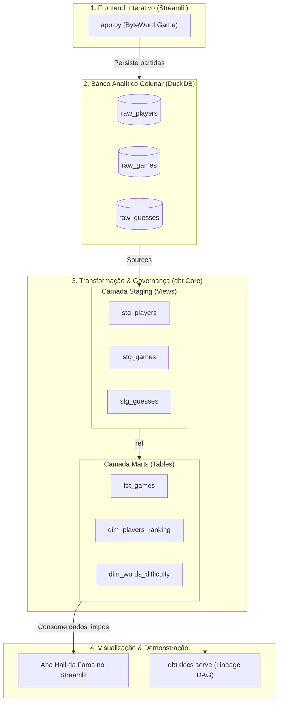

# ⚡ ByteWord: dbt Core + DuckDB + Streamlit

Uma solução moderna e interativa de Engenharia e Modelagem de Dados de ponta a ponta, desenvolvida para demonstrar o poder e as melhores práticas do ecossistema de **Modern Data Stack** local: **dbt Core**, **DuckDB** e **Streamlit**.

---

## 🎯 Visão Geral da Arquitetura

O projeto une gamificação e engenharia analítica corporativa:
1. **Frontend & Coleta:** Uma aplicação web interativa desenvolvida em **Streamlit** no estilo *ByteWord*, desafiando o usuário a adivinhar palavras técnicas de 5 letras (ex: `QUERY`, `TABLE`, `INDEX`, `SPARK`, `CLOUD`). Cada palpite e partida é gravado em tempo real no banco colunar local **DuckDB** (`data/byteword.duckdb`).
2. **Transformação & Governança:** Projeto completo em **dbt Core** orquestrando camadas padronizadas (**Sources**, **Staging**, **Marts**), macros Jinja modulares e testes automatizados de qualidade.
3. **Consumo & BI:** Painel com Leaderboard (Hall da Fama), métricas analíticas por jogador e análise de dificuldade das palavras, além de linhagem de dados navegável no **dbt docs**.



---

## 📂 Estrutura do Projeto

```text
dbt/
├── app.py                      # Aplicação Streamlit (Jogo + Leaderboard + Painel dbt)
├── db.py                       # Conexão e gerenciamento DuckDB otimizado para concorrência
├── seed_data.py                # Gerador de partidas sintéticas para inicializar o ambiente
├── requirements.txt            # Dependências Python
├── README.md                   # Documentação executiva e roteiro de apresentação
├── data/
│   └── byteword.duckdb         # Banco analítico DuckDB compartilhado
└── analytics_dbt/              # Projeto dbt Core
    ├── dbt_project.yml         # Configurações do projeto e materializações
    ├── profiles.yml            # Adapter DuckDB com suporte a variáveis de ambiente
    ├── macros/
    │   └── calculate_score.sql # Macro Jinja com fórmula de pontuação ponderada
    ├── tests/
    │   └── assert_valid_game_duration.sql # Teste singular customizado (regra anti-cheat)
    └── models/
        ├── staging/
        │   ├── sources.yml     # Declaração das fontes brutas (DuckDB)
        │   ├── stg_players.sql # Limpeza e padronização de jogadores
        │   ├── stg_games.sql   # Tipagem e casts de partidas
        │   ├── stg_guesses.sql # Normalização de palpites
        │   └── schema.yml      # Testes de integridade (unique, not_null)
        └── marts/
            ├── fct_games.sql            # Fato de partidas com score calculado
            ├── dim_players_ranking.sql  # Dimensão com ranking, win rate e win streaks
            ├── dim_words_difficulty.sql # Análise de dificuldade dos termos
            └── schema.yml               # Testes de relacionamentos e accepted_values
```

---

## 🚀 Como Executar o Projeto

### 1. Criar o Ambiente Virtual e Instalar Dependências
```powershell
python -m venv .venv
.\.venv\Scripts\activate
pip install -r requirements.txt
```

### 2. Popular os Dados Iniciais
Para que a apresentação comece já com histórico de partidas e jogadores:
```powershell
python seed_data.py
```

### 3. Compilar e Testar os Modelos dbt
```powershell
cd analytics_dbt
dbt build
cd ..
```

### 4. Iniciar a Aplicação Interativa
```powershell
streamlit run app.py
```

---

## 🌐 Como Publicar no GitHub e Fazer o Deploy

O projeto já está com o repositório Git local inicializado e pronto para publicação.

### 1. Conectar ao seu GitHub
Crie um repositório vazio no seu GitHub (ex: `byteword`) e execute:
```powershell
git remote add origin https://github.com/SEU_USUARIO/byteword.git
git push -u origin main
```

### 2. Deploy no GitHub Pages (Versão Showcase Estática)
O projeto conta com o workflow automatizado [`.github/workflows/deploy_pages.yml`](.github/workflows/deploy_pages.yml) e a página estática em `docs/index.html`.
- No seu repositório no GitHub, acesse **Settings** > **Pages**.
- Em **Build and deployment** > **Source**, selecione **GitHub Actions** (ou **Deploy from a branch** > branch `main` / pasta `/docs`).
- O GitHub Actions fará o build automaticamente e disponibilizará o jogo online em:  
  `https://SEU_USUARIO.github.io/byteword/`

### 3. Deploy da Aplicação Completa no Streamlit Community Cloud (Gratuito)
Como o Streamlit + DuckDB + dbt utiliza Python no backend, o deploy oficial recomendado é o **Streamlit Community Cloud**:
1. Acesse [share.streamlit.io](https://share.streamlit.io/) e faça login com sua conta do GitHub.
2. Clique em **"New app"**.
3. Selecione o repositório `byteword`, branch `main` e o arquivo principal `app.py`.
4. Clique em **"Deploy!"**.
5. Em menos de 2 minutos sua aplicação com DuckDB, dbt e Streamlit estará pública em uma URL HTTPS acessível de qualquer dispositivo.
