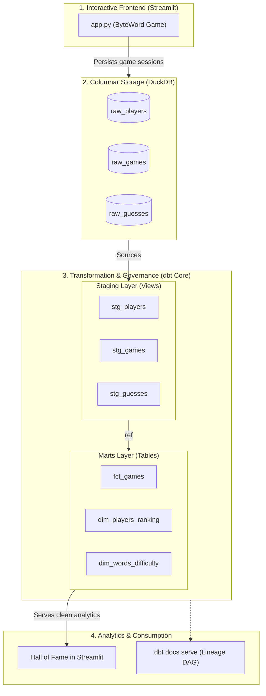

# ByteWord: dbt Core + DuckDB + Streamlit

[](https://byte-word.streamlit.app/)
[](https://www.python.org/)
[](https://www.getdbt.com/)
[](https://duckdb.org/)

> **Live Application:** [https://byte-word.streamlit.app/](https://byte-word.streamlit.app/)

A modern, end-to-end Data & Analytics Engineering solution demonstrating best practices in the local and cloud **Modern Data Stack**: **dbt Core**, **DuckDB**, and **Streamlit**.

---

## Architecture Overview

The project combines gamification with enterprise analytics engineering:
1. **Frontend & Event Ingestion:** An interactive web game built with **Streamlit** where players guess 5-letter technical terms (e.g., `QUERY`, `TABLE`, `INDEX`, `SPARK`, `CLOUD`). Every guess and game session is persisted in real time into an embedded **DuckDB** columnar database (`data/byteword.duckdb`).
2. **Transformation & Governance:** A complete **dbt Core** project orchestrating standardized data layers (**Sources**, **Staging**, **Marts**), reusable Jinja macros, and automated data quality tests.
3. **BI & Analytics:** An in-app Hall of Fame leaderboard, player performance metrics, term difficulty analysis, and interactive data lineage via **dbt docs**.



---

## Project Structure

```text
dbt/
├── app.py                      # Streamlit application (Game + Hall of Fame)
├── db.py                       # DuckDB connection manager optimized for concurrency
├── words_validator.py          # Multilingual dictionary validation (EN and PT-BR)
├── seed_data.py                # Synthetic dataset generator for bootstrapping
├── requirements.txt            # Python dependencies
├── README.md                   # Project documentation
├── assets/
│   └── logo.png                # Official ByteWord logo
├── data/
│   ├── byteword.duckdb         # Embedded DuckDB database
│   └── valid_words.txt         # Valid 5-letter word dictionary
├── byteword_component/         # Interactive custom component (board and physical/virtual keyboard)
└── analytics_dbt/              # dbt Core project
    ├── dbt_project.yml         # Project configurations and materializations
    ├── profiles.yml            # DuckDB adapter with environment variable support
    ├── macros/
    │   └── calculate_score.sql # Jinja macro implementing weighted scoring formula
    ├── tests/
    │   └── assert_valid_game_duration.sql # Custom singular test (anti-cheat business rule)
    └── models/
        ├── staging/
        │   ├── sources.yml     # Raw source declarations (DuckDB)
        │   ├── stg_players.sql # Player whitespace trimming and standardization
        │   ├── stg_games.sql   # Game typing, casting, and uppercase normalization
        │   ├── stg_guesses.sql # Guess attempt normalization
        │   └── schema.yml      # Contract tests (unique, not_null)
        └── marts/
            ├── fct_games.sql            # Fact table with computed score
            ├── dim_players_ranking.sql  # Player dimension with ranking, win rates & streaks
            ├── dim_words_difficulty.sql # Word difficulty classification
            └── schema.yml               # Relationship and accepted_values tests
```

---

## How to Run Locally

### 1. Create Virtual Environment and Install Dependencies
```powershell
python -m venv .venv
.\.venv\Scripts\activate
pip install -r requirements.txt
```

### 2. Bootstrap Initial Data
Populate the database with sample game sessions and players:
```powershell
python seed_data.py
```

### 3. Build and Test dbt Models
```powershell
cd analytics_dbt
dbt build
cd ..
```

### 4. Launch the Interactive Application
```powershell
streamlit run app.py
```

---

## Production Deployment

The application is fully deployed and accessible via **Streamlit Community Cloud**:

🔗 **Live URL:** [https://byte-word.streamlit.app/](https://byte-word.streamlit.app/)

Deployments automatically sync with commits pushed to the `main` branch of this GitHub repository. The full stack (interactive Streamlit frontend, DuckDB columnar persistence, and dbt Core transformations) runs seamlessly in the cloud with zero infrastructure overhead.

---

## GitHub Repository Configuration (About)

Settings for the repository header and sidebar:

- **Description:**  
  `Tech game powered by Streamlit, DuckDB, and an end-to-end dbt Core analytical pipeline (ELT, Jinja macros, ranking marts & data quality tests).`
- **Website:**  
  `https://byte-word.streamlit.app/`
- **Topics (Tags):**  
  `dbt`, `duckdb`, `streamlit`, `data-engineering`, `analytics-engineering`, `modern-data-stack`, `game-analytics`, `python`
