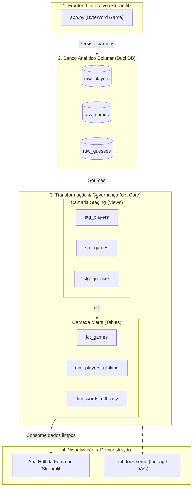

# ⚡ ByteWord: dbt Core + DuckDB + Streamlit

[](https://byte-word.streamlit.app/)
[](https://www.python.org/)
[](https://www.getdbt.com/)
[](https://duckdb.org/)

> 🎮 **Acesse a aplicação ao vivo:** [https://byte-word.streamlit.app/](https://byte-word.streamlit.app/)

Uma solução moderna e interativa de Engenharia e Modelagem de Dados de ponta a ponta, desenvolvida para demonstrar o poder e as melhores práticas do ecossistema de **Modern Data Stack** local e em nuvem: **dbt Core**, **DuckDB** e **Streamlit**.

---

## 🎯 Visão Geral da Arquitetura

O projeto une gamificação e engenharia analítica corporativa:
1. **Frontend & Coleta:** Uma aplicação web interativa desenvolvida em **Streamlit** no estilo *ByteWord*, desafiando o usuário a adivinhar palavras técnicas de 5 letras (ex: `QUERY`, `TABLE`, `INDEX`, `SPARK`, `CLOUD`). Cada palpite e partida é gravado em tempo real no banco colunar local **DuckDB** (`data/byteword.duckdb`).
2. **Transformação & Governança:** Projeto completo em **dbt Core** orquestrando camadas padronizadas (**Sources**, **Staging**, **Marts**), macros Jinja modulares e testes automatizados de qualidade.
3. **Consumo & BI:** Painel com Leaderboard (Hall da Fama), métricas analíticas por jogador e análise de dificuldade das palavras, além de linhagem de dados navegável no **dbt docs**.



---

## 📂 Estrutura do Projeto

```text
dbt/
├── app.py                      # Aplicação Streamlit (Jogo + Hall da Fama)
├── db.py                       # Conexão e gerenciamento DuckDB otimizado para concorrência
├── words_validator.py          # Validação multilíngue de dicionário (EN e PT-BR)
├── seed_data.py                # Gerador de partidas sintéticas para inicializar o ambiente
├── requirements.txt            # Dependências Python
├── README.md                   # Documentação executiva
├── assets/
│   └── logo.png                # Logo oficial do ByteWord
├── data/
│   ├── byteword.duckdb         # Banco analítico DuckDB compartilhado
│   └── valid_words.txt         # Dicionário de termos válidos
├── byteword_component/         # Componente web interativo (tabuleiro e teclado físico/virtual)
└── analytics_dbt/              # Projeto dbt Core
    ├── dbt_project.yml         # Configurações do projeto e materializações
    ├── profiles.yml            # Adapter DuckDB com suporte a variáveis de ambiente
    ├── macros/
    │   └── calculate_score.sql # Macro Jinja com fórmula de pontuação ponderada
    ├── tests/
    │   └── assert_valid_game_duration.sql # Teste singular customizado (regra anti-cheat)
    └── models/
        ├── staging/
        │   ├── sources.yml     # Declaração das fontes brutas (DuckDB)
        │   ├── stg_players.sql # Limpeza e padronização de jogadores
        │   ├── stg_games.sql   # Tipagem e casts de partidas
        │   ├── stg_guesses.sql # Normalização de palpites
        │   └── schema.yml      # Testes de integridade (unique, not_null)
        └── marts/
            ├── fct_games.sql            # Fato de partidas com score calculado
            ├── dim_players_ranking.sql  # Dimensão com ranking, win rate e win streaks
            ├── dim_words_difficulty.sql # Análise de dificuldade dos termos
            └── schema.yml               # Testes de relacionamentos e accepted_values
```

---

## 🚀 Como Executar Localmente

### 1. Criar o Ambiente Virtual e Instalar Dependências
```powershell
python -m venv .venv
.\.venv\Scripts\activate
pip install -r requirements.txt
```

### 2. Popular os Dados Iniciais
Para que o ambiente inicie já com histórico de partidas e jogadores:
```powershell
python seed_data.py
```

### 3. Compilar e Testar os Modelos dbt
```powershell
cd analytics_dbt
dbt build
cd ..
```

### 4. Iniciar a Aplicação Interativa
```powershell
streamlit run app.py
```

---

## 🌐 Deploy em Produção

A aplicação completa está implantada e disponível publicamente no **Streamlit Community Cloud**:

🔗 **URL da Aplicação:** [https://byte-word.streamlit.app/](https://byte-word.streamlit.app/)

O deploy é sincronizado automaticamente com os commits da branch `main` deste repositório GitHub. Toda a suíte (frontend interativo em Streamlit, persistência colunar DuckDB e transformações dbt Core) roda de ponta a ponta na nuvem com zero custo de infraestrutura.

---

## 📋 Configuração Recomendada para o GitHub (About)

Para configurar o cabeçalho e a barra lateral do repositório no GitHub:

- **Description:**  
  `🎮 Wordle-style tech game powered by Streamlit, DuckDB, and an end-to-end dbt Core analytical pipeline (ELT, Jinja macros, ranking marts & data quality tests).`
- **Website:**  
  `https://byte-word.streamlit.app/`
- **Topics (Tags):**  
  `dbt`, `duckdb`, `streamlit`, `data-engineering`, `analytics-engineering`, `modern-data-stack`, `wordle`, `game-analytics`, `python`
